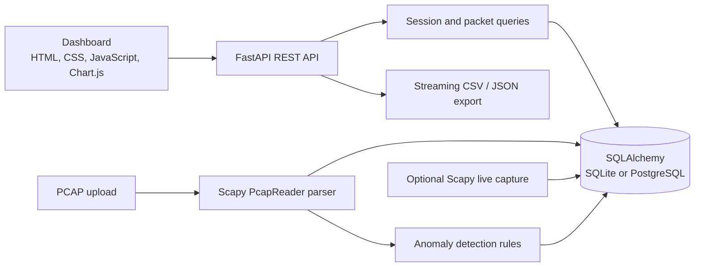

# NetScope: Network Traffic Analyzer

NetScope parses PCAP captures, stores packet and session metadata, summarizes traffic, detects rule-based anomalies, and serves a browser dashboard and REST API. PCAP processing streams packets through Scapy's `PcapReader`; it does not read a whole capture into memory. Live capture is an optional local/VM feature.

## Screenshots

These screenshots use synthetic normal-traffic and port-scan captures. They do not include the private `samples/normal_mixed.pcap` capture.

### Dashboard overview


### Alerts panel


### Charts


### Mobile dashboard


### Regenerate screenshots

Install development dependencies and Playwright's Chromium browser, then run the script from the repository root:

```powershell
python -m pip install -r requirements-dev.txt
python -m playwright install chromium
python scripts/take_screenshots.py
```

The script starts a temporary local Uvicorn server with a fresh SQLite database, uploads only `samples/synthetic/synthetic_normal_traffic.pcap` and `samples/synthetic/port_scan.pcap` through the API, waits for analysis, and saves the four PNGs under `docs/screenshots/`. Each generated image is checked to remain below 500 KB. No live capture is enabled.

## Architecture



## Setup and run

Requires Python 3.11 or later. From the repository root:

```powershell
python -m venv .venv
.venv\Scripts\Activate.ps1
python -m pip install -r requirements.txt
uvicorn app.main:app --reload
```

Open <http://127.0.0.1:8000/> for the dashboard and <http://127.0.0.1:8000/docs> for interactive API documentation. The default database is `./netscope.db`. Set `DATABASE_URL` to use another SQLAlchemy database URL; PostgreSQL works with the included psycopg driver.

To generate the synthetic captures used by tests, development, and screenshots:

```powershell
python scripts/generate_sample_pcaps.py
```

Real and synthetic PCAPs are intentionally ignored by Git. Keep private captures out of screenshots, docs, and commits.

## Tests and lint

Install the developer tools and run them at the repository root:

```powershell
python -m pip install -r requirements-dev.txt
pytest -v
ruff check .
```

The tests cover parser classification and real/synthetic captures, database models, API behavior, detection rules, and UTC timestamp serialization. Private `normal_mixed.pcap` data is not required by the core test suite.

## API summary

All API routes are under `/api`. OpenAPI schemas and an interactive Swagger UI are available at `/docs`.

| Method | Path | Purpose |
| --- | --- | --- |
| GET | `/health` | Check service and database connectivity |
| POST | `/api/sessions/upload` | Upload and analyze a `.pcap`, `.pcapng`, or `.cap` capture |
| GET | `/api/sessions` | List capture sessions |
| GET | `/api/sessions/{id}` | Read session status and metadata |
| DELETE | `/api/sessions/{id}` | Delete a session and its associated records |
| GET | `/api/sessions/{id}/summary` | Packet/byte totals, protocol split, top endpoints/ports, and traffic time series |
| GET | `/api/sessions/{id}/packets` | Filter and paginate packets by protocol, addresses, port, or time range |
| GET | `/api/sessions/{id}/alerts` | List alerts for a session |
| GET | `/api/sessions/{id}/export?format=csv\|json` | Stream packet data; JSON includes alerts |
| GET | `/api/capture/interfaces` | List interfaces when live capture is enabled |
| POST | `/api/capture/start` | Start optional interface capture (interface and optional BPF filter) |
| POST | `/api/capture/stop` | Stop the active capture |
| GET | `/api/capture/status` | Read live capture state |

Timestamps in API responses are timezone-aware UTC ISO-8601 strings ending in `Z`. The dashboard labels displayed times as UTC.

## Detection rules

The detector runs after PCAP processing and writes evidence-bearing alerts to the session. Rule thresholds can be adjusted with environment variables; defaults are defined in `app/config.py`.

| Rule | Default behavior | Environment settings |
| --- | --- | --- |
| Port scan | A source contacts over 20 distinct destination ports on one target within 60 seconds | `PORT_SCAN_DISTINCT_PORTS`, `PORT_SCAN_WINDOW_SECONDS` |
| SYN flood | Over 100 SYN packets target one host within 10 seconds | `SYN_FLOOD_THRESHOLD`, `SYN_FLOOD_WINDOW_SECONDS` |
| Long DNS name | DNS query name exceeds 100 characters | `DNS_MAX_QUERY_LENGTH` |
| NXDOMAIN rate | At least 20 queries with an NXDOMAIN ratio of 50% or more | `DNS_NXDOMAIN_MIN_QUERIES`, `DNS_NXDOMAIN_RATE` |
| DNS query rate | Over 50 queries from one source within 10 seconds | `DNS_QUERY_RATE_THRESHOLD`, `DNS_QUERY_RATE_WINDOW_SECONDS` |
| ICMP flood | Over 100 ICMP packets per second from one source | `ICMP_FLOOD_PPS` |

## Docker

The image uses Python 3.11 slim, runs as the unprivileged `netscope` user, exposes a health check at `/health`, and listens on the port in `$PORT` (8000 by default). It stores its SQLite database at `/data/netscope.db` by default. A local Docker named volume keeps that database across container replacement:

```powershell
docker build -t netscope .
docker volume create netscope-data
docker run --rm -p 8000:8000 -v netscope-data:/data netscope
```

Set `DATABASE_URL` to connect to PostgreSQL instead. The Docker build context excludes `samples/`, tests, screenshots, and development requirements.

Cloud mode handles PCAP upload, analysis, API access, exports, and the dashboard. Live capture is disabled by default and is intended for a local machine or VM with suitable network access and elevated packet-capture privileges. Cloud services generally cannot sniff a user's network interface. Only capture networks you own or are authorized to monitor.

## Render deployment

NetScope deploys as a Docker web service. Live capture should remain disabled in cloud deployments; use a local machine or VM for authorized interface capture.

1. Push the repository to a Git provider connected to Render.
2. In the Render dashboard, choose **New → Web Service**, connect the repository, and select **Docker** as the runtime. The Dockerfile is at the repository root, so leave its path at `Dockerfile`.
3. Choose a region and instance plan. In **Advanced**, set the health check path to `/health`. Create the service. Render builds and runs the Dockerfile's `CMD`; the app binds to Render's `$PORT`.
4. In the service's **Environment** settings, add `ENABLE_LIVE_CAPTURE=false`. Render's Docker services receive environment variables at runtime.
5. Deploy and check `https://<service>.onrender.com/health`, then open the dashboard at the service root.
6. For persistent session storage, create a Render Postgres database in the same region and set the service's `DATABASE_URL` to the database's internal URL. Use that same environment-variable name shown in the database connect details.

Render's free web services use an ephemeral filesystem: local SQLite data, including uploaded sessions, is lost when the service restarts, spins down, or redeploys. Free web services cannot attach persistent disks. Use PostgreSQL for data that must survive those events; note that Render's free Postgres databases currently expire 30 days after creation. Paid services can use a persistent disk for SQLite, mounted at `/data`, but PostgreSQL is the better choice for relational session data and scaling. See Render's [Docker deployment guide](https://render.com/docs/docker), [free instance limitations](https://render.com/docs/free), [persistent disk documentation](https://render.com/docs/disks), and [Postgres connection instructions](https://render.com/docs/postgresql-creating-connecting).

Render database URLs may start with `postgres://`. NetScope's SQLAlchemy engine converts `postgres://` and `postgresql://` to the psycopg driver URL automatically, so either form can be placed in `DATABASE_URL` without editing the database URL by hand.
