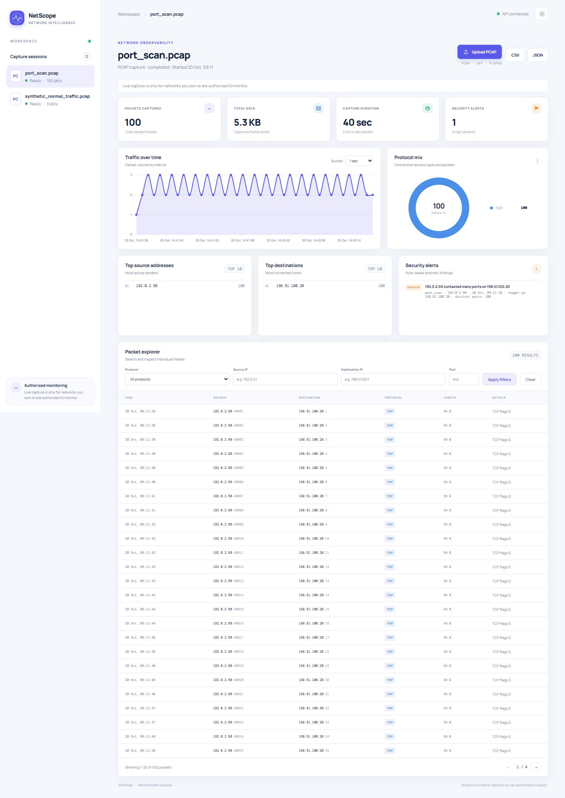
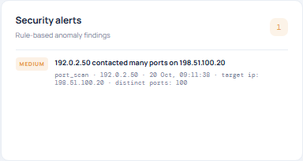
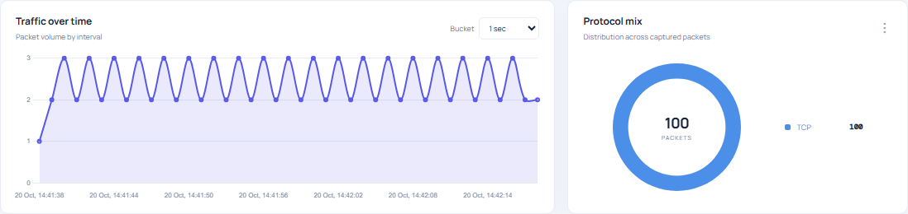
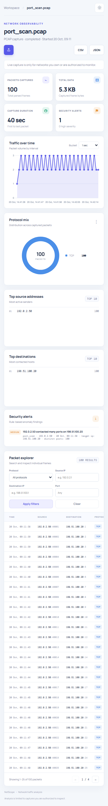

# NetScope

NetScope analyzes packet captures to summarize protocols, traffic rates, endpoints, and rule-based security alerts.

## Screenshots

These dashboard screenshots are generated from the synthetic normal-traffic and port-scan captures. They contain no personal browsing capture data.

**Dashboard overview:** the port-scan session with its summary, charts, endpoints, alerts, and packet table.



**Alerts panel:** anomaly findings produced for the synthetic port scan.



**Charts:** protocol distribution and packet traffic over time.



**Mobile layout:** the dashboard rendered at a 390 pixel viewport width.



### Regenerate screenshots

From the repository root, install the development dependencies and Chromium once, then run the capture script:

```powershell
python -m pip install -r requirements-dev.txt
python -m playwright install chromium
python scripts/take_screenshots.py
```

The script starts a temporary local Uvicorn server with a fresh SQLite database, uploads only `samples/synthetic/synthetic_normal_traffic.pcap` and `samples/synthetic/port_scan.pcap` through the API, waits for analysis, and saves the four PNGs under `docs/screenshots/`. Each generated image is checked to remain below 500 KB. No live capture is enabled.
